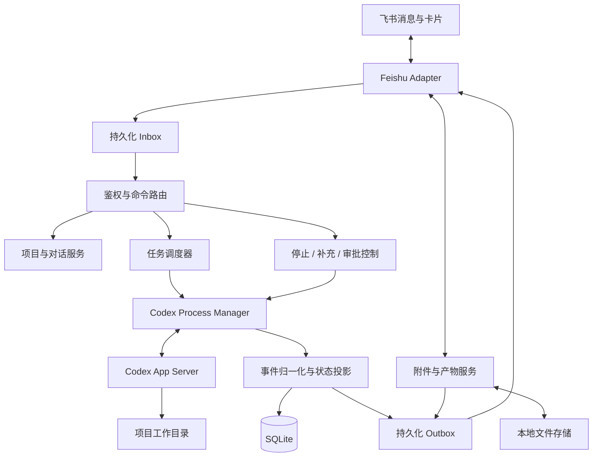

# CodexConnector 架构与实施计划

> 实现状态（2026-10-10）：首版代码与独立测试已完成。下文保留设计过程；实际配置与运行行为以 `config.example.yaml`、`docs/operations.md` 为准，验证范围见 `docs/test-report.md`。
>
> 实现调整：使用 Node 24 内置 `node:sqlite`，避免 Windows 原生模块编译；SQLite 表保存类型化 JSON 并索引关键字段。模块按 application/adapters/platform 分组，未为每个用例拆独立包。`/send-path` 遇忙返回可重试提示，不在后台等待。Outbox 使用统一重试计数，保存已上传 file_key；显式 `/retry` 可重新上传快照。Git 忽略项由项目维护者设置。doctor 检查 CLI/登录/机器人身份，任务与交付状态通过聊天命令查看。Windows 提供当前用户后台启停脚本，尚未注册登录自启动。输入文件随可恢复会话保留，项目内工作文件不计入外部 blob 配额。配置使用 `sandbox` 字段，凭据独立从环境文件加载。

状态：设计草案，尚未实现或联调。日期：2026-10-09。

## 1. 目标与设计决策

通过飞书操作本机 Codex，覆盖项目选择、任务执行、连续对话、新建与切换对话、状态查询、停止、结果回传、双向文件传输，以及执行所必需的审批和追问。

采用单仓库、模块化单体：一个 Node.js 服务、一份 SQLite 数据库、按项目惰性启动的 Codex App Server 子进程。无需 Redis、独立消息队列、Web 管理后台或额外的路由模型。

| 决策 | 初始选择 | 原因 |
| --- | --- | --- |
| 语言 | TypeScript，strict 模式 | 飞书 SDK 与协议类型整合方便 |
| 运行时 | Node.js 受支持 LTS，锁定具体版本 | 安装时验证 Windows 与 SQLite 驱动兼容性 |
| 飞书 | 官方 Node SDK，WebSocket 长连接 | 本机主动出站连接，无需公网入口 |
| Codex | App Server，stdio JSON-RPC | 双向交互、进度、审批和取消 |
| 数据库 | SQLite，WAL、外键、版本化 SQL migrations | 满足单机持久化与队列需求 |
| 数据访问 | better-sqlite3 + 小型 repository | 明确事务边界，不引入通用 ORM 框架 |
| 校验与日志 | Zod、Pino | 配置及边界数据校验、关联日志 |
| 测试 | Vitest + 假 Codex 子进程 + 临时 SQLite | 验证协议、故障恢复和状态转换 |
| 使用范围 | 本人私聊优先，数据模型支持群话题隔离 | 最先验证完整闭环 |
| 并发 | 每个工作区最多一个执行中任务，全局默认两个 | 防止多个任务交叉修改同一目录 |

默认项目直接使用现有工作目录。worktree 自动创建、桌面已有线程接管、双端实时同步、定时任务、多租户和远程执行器不作为首版依赖。

本文中的超时、并发、大小限制是产品建议值，不是平台官方配额。协议字段和可用能力以锁定版本生成的 schema 为准。

## 2. 总体结构



消息接收、任务执行、结果交付是三个独立循环。Codex 执行耗时不会阻塞飞书事件确认；飞书断线不会自动重跑 Codex；审批和停止不会排在长任务后面。

## 3. 交互契约

命令是确定性解析，普通文本直接作为任务输入。卡片按钮调用与命令相同的应用服务，避免两套行为。命令参数按明确的引号规则解析，永不作为 shell 字符串执行。

| 输入 | 行为 |
| --- | --- |
| `/projects` | 列出允许访问的项目及当前选择，支持卡片选择 |
| `/project <alias>` | 切换项目，恢复该用户在当前飞书范围内对该项目最近选中的对话；没有则创建 |
| 普通文本 | 在当前对话创建任务；没有项目时先选择项目，不猜测目录 |
| `/new [title]` | 当前项目下创建新对话并选中；旧任务继续运行，结果仍返回旧任务上下文 |
| `/sessions` | 列出当前项目下本人在当前范围内可访问的对话 |
| `/use <session-id>` | 切换已有对话，校验归属与项目 |
| `/status [task-id]` | 显示任务、项目、对话、耗时、阶段、队列和交付状态 |
| `/tasks` | 列出当前范围内本人可访问的活跃及最近任务，方便跨项目找到旧任务 |
| `/stop [task-id]` | 停止执行中任务，或取消指定排队任务；无 ID 时针对当前对话活跃任务 |
| `/stop --all` | 停止当前对话活跃任务并取消其排队任务，不影响其他对话 |
| `/steer <text>` | 给当前执行中任务补充指令；没有活跃任务则明确报错，不悄悄新建任务 |
| `/continue` | 显式恢复因停止、失败或故障而暂停的当前对话队列；不重复执行旧任务 |
| `/files` | 列出当前对话待使用的输入附件及可发送产物 |
| `/send <artifact-id>` | 将已登记产物发送到其授权的当前会话 |
| `/send-path "relative/path"` | 用户显式选择项目内文件，验证并生成快照后发送 |
| `/approve <request-id>`、`/deny <request-id>` | 处理明确的审批；首版默认仅批准本次请求 |
| `/answer <request-id> <text>` | 回答 Codex 追问，按请求 schema 校验 |
| `/help` | 简短命令清单 |

运行中普通文本默认排队。存在待回答问题时提示使用卡片或 `/answer`，不把含糊的“好”自动解释为授权。回复机器人问题消息时，可通过消息关联精确定位问题。

`/stop` 成功表示执行停止，不表示代码回滚。任务卡片固定显示项目、对话短 ID、任务短 ID，并带状态、停止和结果文件操作。

## 4. 核心对象与身份映射

- Project：配置中的项目别名、绝对目录、工作区锁键、权限配置、产物规则。
- Scope：飞书租户、机器人账号、chat_id、话题根 ID；私聊无话题时使用固定空值。
- Cursor：`scope + actor` 对应当前项目；`scope + actor + project` 对应当前对话。
- Session：网关对话，一对一绑定一个 Codex thread；项目及工作目录创建后固定。
- Task：一次普通用户请求，对应一次 Codex turn；补充指令不创建新的 task。
- Interaction：一次审批或追问，包含 Codex request ID、进程代次及有效期。
- Attachment：用户发送的文件或图片，具有上传者、来源消息、所属对话与使用状态。
- Artifact：可发回飞书的不可变文件快照，具有归属、大小、哈希和交付记录。

网关内部 ID 与 Codex ID 分开，用户只需操作短 ID；数据库使用完整 UUID。引用 Codex 线程不授予访问权，所有入口均重新检查 actor、scope 和 project。

群聊默认按话题及发送者隔离执行上下文，群内结果对群成员可见，不能视为私人通道。共享对话作为后续显式配置，不默认将群内每个人接到同一线程。

关键不变量：任务创建时冻结 `session_id + project_id + cwd + reply_target + input_attachments`。之后切换项目、新建对话、编辑配置都不改变已有任务的目标。

## 5. 代码目录与职责

```text
CodexConnector/
  package.json
  tsconfig.json
  config.example.yaml
  .env.example
  docs/
    architecture.md
    operations.md
  src/
    main.ts                       # 启停、信号处理
    bootstrap.ts                  # 显式组装依赖，不使用 DI 框架
    config/
      schema.ts                   # 配置结构与默认值
      load.ts                     # YAML、环境变量、路径验证
    domain/
      models.ts                   # Project / Session / Task / Artifact
      task-state.ts               # 合法状态转换
      errors.ts                   # 面向用户的错误分类
    application/
      ingress-service.ts          # 事件鉴权、持久化、去重
      command-router.ts           # 指令解析及分派
      project-service.ts          # 项目选择、当前游标
      session-service.ts          # 新建、切换、恢复对话
      task-service.ts             # 创建任务、停止、steer
      scheduler.ts                # 工作区互斥、限并发、公平调度
      interaction-service.ts      # 审批、追问、过期处理
      event-projector.ts          # Codex 事件转本地状态与交付意图
      recovery-service.ts         # 启动对账、异常任务恢复
      delivery-service.ts         # Outbox、重试、节流、分片
      artifact-service.ts         # 附件关联、产物登记、快照、发送
    adapters/
      feishu/
        client.ts                 # 官方 SDK 初始化与 token 管理
        ingress.ts                # 消息和卡片回调归一化
        commands.ts               # 飞书命令及引用消息提取
        cards.ts                  # 项目、状态、审批、结果卡片
        messages.ts               # 回复、更新、分片与降级
        resources.ts              # 消息资源下载、文件上传
      codex/
        process-manager.ts        # 按项目启动、关闭、代次管理
        jsonrpc.ts                # ID、超时、双向请求、JSONL 分帧
        client.ts                 # thread / turn / response 操作
        events.ts                 # 协议事件转内部事件
        compatibility.ts          # 版本、能力与 schema 校验
        generated/                # 由锁定 Codex 版本生成的类型
      persistence/
        database.ts               # WAL、事务、迁移
        migrations/
        session-repository.ts
        task-repository.ts
        message-repository.ts     # Inbox / Outbox
        artifact-repository.ts
        interaction-repository.ts
      filesystem/
        paths.ts                  # realpath、边界、链接检查
        blob-store.ts             # 临时下载、哈希、原子重命名
        artifact-manifest.ts      # 声明清单解析与验证
        retention.ts              # 清理不再引用的文件
    platform/
      process-tree.ts             # Windows/POSIX 子进程树生命周期
      instance-lock.ts            # 单实例锁
    observability/
      logger.ts
      health.ts                   # 本地诊断，不默认开放网络端口
    cli/
      index.ts                    # run / doctor / config check
  tests/
    unit/
    integration/
    contract/
    fixtures/
      fake-codex.ts
```

这是模块边界规划，不要求第一天创建所有空文件。小模块可先合并，业务增长时沿这些边界拆开。

依赖方向：domain 不依赖 SDK 或数据库；application 调用具体职责的边界接口；adapters 实现外部交互；bootstrap 负责组装。飞书模块不直接启动 Codex，Codex 模块不直接发飞书消息。

不建设通用插件框架、全局事件总线或多模型代理层。只抽象 CodexClient、消息发送与文件资源边界，以及需要事务的数据库访问，便于模拟测试。

## 6. 关键内部接口

下列是设计层接口，非承诺与某个 Codex SDK 类型完全相同：

```ts
interface CodexClient {
  ensureThread(session: Session): Promise<{ threadId: string }>;
  startTurn(task: PreparedTask): Promise<{ turnId: string }>;
  steer(threadId: string, expectedTurnId: string, text: string): Promise<void>;
  interrupt(threadId: string, turnId: string): Promise<void>;
  respond(request: LiveRequestRef, answer: ValidatedAnswer): Promise<void>;
  readThread(threadId: string): Promise<ThreadSnapshot>;
  onEvent(handler: (event: CodexEventEnvelope) => void): () => void;
}

interface MessageTransport {
  send(intent: DeliveryIntent): Promise<DeliveryReceipt>;
  update(receipt: DeliveryReceipt, payload: RenderedMessage): Promise<void>;
  download(resource: MessageResourceRef, target: string): Promise<void>;
  upload(snapshot: ArtifactSnapshot): Promise<UploadedFile>;
}

interface ArtifactService {
  receive(input: IncomingAttachment): Promise<Attachment>;
  prepareInputs(taskId: string): Promise<PreparedInput[]>;
  collect(taskId: string): Promise<Artifact[]>;
  requestSend(actor: Actor, target: ReplyTarget, artifactId: string): Promise<void>;
}
```

协议层只处理请求/响应关联与事件解码；业务超时、任务状态、重试策略放在应用层。JSON-RPC 普通请求与服务器发起的审批请求分别建表/映射，不能只按一个数字 ID 混用。

## 7. 数据存储

项目配置以 YAML 为来源，数据库保存稳定 project ID 与配置版本；任务记录实际使用的目录和配置快照。配置更改在重启生效，已有对话目录不随配置漂移，变更目录须创建新对话。

| 表 | 主要字段与约束 |
| --- | --- |
| `projects` | id、alias unique、canonical_root、workspace_key、config_revision、enabled |
| `cursors` | scope_key、actor_id、project_id、session_id、version；scope/actor/project 唯一 |
| `scope_preferences` | scope_key、actor_id、selected_project_id；scope/actor 唯一 |
| `sessions` | id、scope_key、actor_id、project_id、cwd、codex_thread_id、title、queue_paused、created_at |
| `tasks` | id、session_id、inbox_id unique、prompt、state、turn_id、process_generation、dispatch_attempt_id、reply_target_json、config_snapshot、timestamps、error |
| `inbox` | id、app_id、tenant_id、event_id、message_id、kind、actor、scope、payload、state、receive_sequence；事件身份唯一 |
| `outbox` | id、logical_key unique、task_id nullable、reply_target、kind、payload、state、attempts、next_attempt_at、remote_message_id、revision |
| `interactions` | id、task_id、session_id、request_id、process_generation、kind、schema、state、actor_id、expires_at、answer |
| `attachments` | id、source_message_id、resource_key、owner、session_id、task_id nullable、original_name、blob_path、size、sha256、state |
| `artifacts` | id、task_id、owner、source_path、snapshot_path、display_name、size、sha256、state |
| `task_events` | id、task_id、kind、item_id、local_sequence、summary_json、created_at |

`inbox` 另按消息身份去重：同一机器人/租户下重复的 message_id 不再创建任务；卡片点击是独立事件，不能因关联同一张卡片而被错误去重。缺失 event_id 时使用 SDK 可验证的回调身份或有界重放键，不凭文本内容去重。

`tasks(state, created_at)`、`outbox(state, next_attempt_at)`、`sessions(scope_key, actor_id, project_id)` 建索引。所有时间保存 UTC，用户展示使用配置时区。

关键事务：

1. 入站事务保存事件，落盘成功后才确认接收；具体 SDK ACK 时点须通过适配器测试验证。
2. 路由事务更新游标或创建任务，同时写“已接收”Outbox，输入附件同时认领。
3. 状态投影事务更新任务并写对应交付意图；完成通知使用唯一逻辑键。
4. 审批使用 compare-and-set，从 pending 转 responding，只有一个回答可胜出。

不把网络请求或 Codex 调用放在数据库事务内。完整上下文由 Codex 保存，网关保留提示、必要结果与状态；不长期保存全部 token delta 或内部推理内容。

## 8. 消息处理与调度

入站顺序：验证平台来源和发送者 -> 归一化 -> Inbox -> 按 scope/actor 做短时串行路由 -> 冻结目标 -> Task/Outbox。按接收顺序定义项目切换语义，不承诺重建网络乱序前的真实发送顺序。

执行顺序：等待附件就绪 -> 取得工作区锁 -> 确认对话线程 -> 写 starting 和 dispatch_attempt_id -> 调用 startTurn -> 绑定 turnId -> 消费事件 -> 保存结果 -> 收集产物 -> 交付。

同一个 session 不允许两个活跃 turn。同一个 canonical workspace 默认只执行一个任务；不同项目别名指向相同目录时共用锁。初始配置拒绝重叠根目录，避免父目录项目与子目录项目被误判为独立工作区。

全局按项目轮转调度，项目内按队列时间执行。等待审批仍占用工作区锁，因为任务可能已修改文件；发送结果和上传不可变产物不占执行锁。

控制命令在路由后直接交给控制服务，不进入执行队列。`/stop` 暂停当前对话队列，等待 `/continue`；普通文本仍可入队并说明暂停原因。停止其他项目任务必须带明确 task ID。

## 9. 状态机与故障恢复

```text
queued -> preparing -> starting -> running -> succeeded
   |          |           |          |
cancelled   failed      recovering    +-> waiting_approval -> running
                                     +-> waiting_input -> running
                                     +-> stopping -> cancelled
                                     +-> failed
                                     +-> recovering -> interrupted_unknown
```

starting 表示已记录发送意图但未确定 Codex 是否接收；不得因请求超时就自动再发一次。任务终态与交付状态独立：任务可以 succeeded，而结果仍 delivery_pending 或 delivery_failed。

恢复规则：

- queued/preparing：重新校验附件和权限后可恢复；临时文件写入具有幂等性。
- starting/running/waiting/stopping：先检查进程归属和 Codex 持久化记录，按已保存的 turn ID 对账。
- 找到可靠的完成记录：补交结果，不重新执行。
- 无法确认是否已执行，特别是 startTurn 已送达但 turn ID 尚未落盘：标记 interrupted_unknown、暂停对话队列并告知用户。不能通过提示文本相同就判断可重试。
- 用户检查现有文件后发出新的继续指令，才创建下一轮；“继续”不保证撤销或重放原任务。
- 本地审批记录不能恢复已经断开的 JSON-RPC 请求。新进程代次使旧请求失效，只处理新进程重新发出的请求。
- 飞书发送重试只处理 Outbox；能使用平台幂等标识时复用稳定标识，超出平台去重窗口或发送响应丢失时仍可能重复交付，不承诺跨系统 exactly-once。

状态卡片按 revision 更新，终态落盘后禁止旧进度覆盖结果。文本增量建议每 1-2 秒合并；消息长度、卡片大小、频率限制按锁定 SDK/API 验证，超长结果拆分或作为文本附件发送。

## 10. Codex 进程与协议管理

每个启用项目按需启动一个 App Server，同项目的空闲对话共享该进程，默认同一时刻只有一个任务运行。线程生命周期独立于进程，空闲回收进程不会删除对话。

使用直接可执行文件和参数数组启动，禁止 shell 拼接用户输入。Windows 上确认安装包 shim 与实际可执行文件的启动方式，纳入安装冒烟测试。stdout 只解析协议，stderr 单独记录并脱敏。

启动流程：检查 CLI 版本和登录状态 -> 创建新 process_generation -> initialize 握手 -> 恢复必要线程 -> 开放调度。锁定 CLI 版本与生成类型，未知事件记录诊断，未知交互请求明确失败或拒绝，不能永久挂起。

`/stop` 先记录取消意图并发送 interrupt。以完成事件或可靠对账作为停止成功依据，不把 RPC 返回直接等同于所有子进程已经结束。建议等待 10 秒后报告仍在停止。

后台命令需要单独考虑：若锁定版本支持可靠的后台终端终止能力则封装；否则硬停止只针对本服务拥有的项目进程树。Windows 优先使用具备 kill-on-close 语义的进程监督方式，必须验证子孙进程清理。无法确认清理完成时隔离该工作区，保持队列暂停，不启动后续任务。

不假设停止能回滚文件，也不杀死用户的其他 Codex 或终端进程。`pid + creation time + generation` 用于核实所有权；共享 CODEX_HOME 不代表可以控制桌面正在运行的线程。

项目沙箱与审批由 Codex 配置执行，cwd 本身不是权限边界。网关的文件目录校验也不能替代 Codex 的命令与网络权限约束。

## 11. 双向文件传输

### 11.1 用户发送给 Codex

文件消息 -> 保存来源 message_id/resource key -> 通过消息资源接口下载 -> 随机临时文件 -> 限流、大小和哈希校验 -> 原子落盘 -> 登记 Attachment -> 回执。

上传时冻结当前 session；没有项目时保留为当前 scope/actor 下的未分配附件，并要求用户选择项目后显式关联。切换项目不迁移已归属附件。

纯文件消息默认只暂存，不自动执行任务。下一条普通文本原子认领该对话内尚未使用的附件，回执列出文件名；再次引用旧附件通过回复原文件消息或明确附件 ID。群消息中的附件只能由其拥有者关联。

下载用户消息资源与下载机器人自己上传的文件可能使用不同接口，必须使用正确的来源消息关联；不能拿一个 file_key 猜测下载路径。首版不自动解压压缩包、不执行上传内容。

给 Codex 的文件位于项目内专用 `.codex-connector/sessions/<id>/inputs/`，原始显示名与随机实际文件名分开。该目录在安装配置时加入本地 Git 排除规则；不修改项目公共 .gitignore。图片可在协议支持时同时作为图像输入，一般文件作为受限本地路径提供。PDF/Office 能否解读取决于执行环境工具，失败需明确反馈。

附件先存在服务数据目录，任务准备时复制到当前工作区，避免默认向 Codex 开放整个网关数据目录。每个任务只注入已认领文件的路径及用户提示。

### 11.2 Codex 产物发送给用户

首版采用“明确产物目录 + 声明清单 + 用户选择”的契约，不从最终答复的任意路径中自动上传文件。

每个任务有独立 `.codex-connector/tasks/<task-id>/exports/`。网关在任务输入中提供准确目录，要求待交付产物与 `artifacts.json` 放在此目录；清单是可选增强，缺失时仅枚举该任务 exports 下符合规则的普通文件。

```json
{
  "artifacts": [
    { "path": "report.pdf", "name": "report.pdf", "description": "分析报告" }
  ]
}
```

模型生成的清单按不可信输入验证：数量、字段长度、相对路径、存在性、大小、文件类型、真实路径归属及链接。清单不授予额外访问权限。

任务结束后先复制成服务数据目录中的不可变快照，计算 sha256，再释放工作区锁。后续修改源文件不会改变将要发送的内容。结果卡片显示文件列表与发送按钮；用户任务明确要求回传文件时，可按配置自动发送该任务已验证的 exports。

`/send-path` 是显式发送既有项目文件的通道：相对当前项目解析，检查 realpath、符号链接/junction、Windows ADS/UNC/设备路径和敏感文件规则；在工作区空闲时创建快照，忙时等待而不是读取半写入文件。禁止目录和通配符；文件名含空格通过引号处理。

上传成功保存 file_key，发送成功保存 message_id。发送失败复用已有上传结果，file_key 失效时重新上传同一快照；不会让 Codex重新生成文件。上传尝试次数和发送尝试次数分别记录在 Outbox payload/state 中。

建议初始单文件上限 20 MiB、每任务最多 10 个自动收集产物、总存储配额与 7 天保留期可配置。这些是本网关策略，实际平台上限以集成测试核定；超限显示大小和原因，提供用户显式拆分或压缩选项，不静默上传外部网盘。

### 11.3 存储分布

```text
%LOCALAPPDATA%/CodexConnector/
  connector.db
  logs/
  blobs/incoming/
  blobs/artifacts/
  tmp/

<project>/.codex-connector/
  sessions/<session-id>/inputs/
  tasks/<task-id>/exports/
```

凭据通过环境变量或 OS 凭据存储注入，不放入项目目录、数据库 payload 或发给模型的提示。清理只覆盖网关管理的路径，保留活跃任务、未交付产物和有引用的附件；删除文件前检查最终绝对路径。过期 Artifact 保留元数据并显示已过期。

## 12. 审批与追问

审批或追问到达后，保存 Interaction 并生成卡片，内容包括项目、任务、实际请求、可选回答；只呈现该请求允许的操作。回调先验证平台身份，再验证 actor、task、request、process_generation 与有效状态。

卡片携带随机的一次性操作 token，真实权限信息由数据库读取；不能相信卡片传回的目录、用户或“允许”字段。过期、重复和跨用户点击只更新提示，不执行操作。

普通审批默认只批准本次；网络、文件、命令、MCP elicitation 和输入问题分别渲染。未知 schema 明确提示不支持并终止/拒绝对应操作。响应成功与最终解决分别记录，断线中的响应不盲目重放。

建议交互等待 30 分钟后中断任务、暂停对话队列；该期限可配置，并与协议自带的自动解决行为对齐。卡片回调不可用时使用 `/approve`、`/deny`、`/answer` 作为文本后备通道。聊天长连接可用不等于已验证所有卡片回调能力。

## 13. 配置与运行

```yaml
feishu:
  appId: ${FEISHU_APP_ID}
  appSecret: ${FEISHU_APP_SECRET}
  allowedOpenIds: [ou_owner]
  groupsEnabled: false
codex:
  executable: codex
  transport: stdio
  idleProcessMinutes: 15
scheduler:
  globalConcurrency: 2
  perWorkspaceConcurrency: 1
files:
  maxBytes: 20971520
  maxArtifactsPerTask: 10
  retentionDays: 7
projects:
  - id: connector
    alias: connector
    root: .
    permissionProfile: workspace-write
    autoSendExports: false
```

配置键为本项目设计，`permissionProfile` 是网关语义，须由 Codex 适配器映射到所用版本支持的设置，不直接当作官方 RPC 字段。

启动前检查项目路径、读写权限、重叠工作区、凭据是否存在、数据库迁移、单实例锁、CLI/SDK 兼容性。通过 `connector doctor` 输出可读诊断，不打印密钥。

开发时前台运行；Windows 常驻优先使用当前用户登录会话下的任务计划程序，保留 Codex 登录、PATH 和项目权限。不要默认安装为不同身份的系统服务。机器睡眠或关机期间不能保证飞书消息被无限期保留。

退出时关闭入站、保存未交付消息、停止或明确中断执行任务、清理自有子进程、关闭数据库。日志关联 event_id/task_id/session_id/turn_id，提示、路径和输出设置可控保留，凭据始终脱敏。

## 14. 实施阶段与验收

| 阶段 | 代码与交付 | 必须通过的验收 |
| --- | --- | --- |
| P0：协议验证 | 临时飞书/Codex探针，锁定版本，生成协议类型 | Windows 启动、真实任务、恢复线程、停止、审批/追问、文件下载上传；记录卡片回调支持情况 |
| P1：基础与路由 | 配置、SQLite、Inbox、项目与对话服务、命令 | 切项目再发消息路由正确；重复事件只建一个任务；重启保留选择 |
| P2：执行闭环 | 进程管理、调度、事件投影、文本 Outbox | 连续对话有上下文；新对话独立；长任务不阻塞 status/stop；同工作区互斥 |
| P3：交互与展示 | 审批、追问、进度卡片、最终结果 | 审批只执行一次；旧按钮失效；补充指令绑定正确 turn；旧进度不覆盖最终状态 |
| P4：双向文件 | 下载、附件认领、exports、快照、上传与发送 | 中文名、空格、超限、链接越界、上传成功发送失败、重启续传状态均正确 |
| P5：恢复与常驻 | 对账、清理、doctor、Windows 常驻、运维说明 | 故障窗口不重复执行；停止清理子进程；飞书断线重连；存储配额与日志脱敏 |

阶段是实现顺序，不是把用户要求推到未来版本：P1-P5 完成后才构成首个完整可用版本。P0 不通过的能力应调整适配方案后再实现业务层。

重点测试不是复制实现细节，而是外部行为与故障边界：

1. 切换项目、新建对话、发送文件与任务混合到达时，既有任务目标不改变。
2. 同一事件重复投递与进程重启后重投不会重复建任务。
3. startTurn 发出后、turn ID 落盘前崩溃进入 unknown，而非自动重跑。
4. Codex 完成后、飞书发送前崩溃只补交结果。
5. stop 与完成事件竞态不把成功误报为取消；stop 后不自动执行下一项。
6. 审批重放、越权回答、进程代次变化不会批准其他请求。
7. 文件链接越界、路径遍历、Windows 特殊路径及敏感文件被拒绝。
8. 源产物被修改后重试发送，仍发送原快照。
9. 项目 A 卡住或崩溃不阻塞项目 B 状态查询与允许的执行。
10. 启停、空闲回收、强制停止不遗留可继续修改文件的自有子进程。

## 15. 官方依据与待验证项

- [OpenAI App Server](https://learn.chatgpt.com/docs/app-server)：双向协议、线程/任务、事件与交互基础。使用 stdio，并针对具体 CLI 版本锁定 schema；官方对 App Server/部分传输存在实验性说明，不能视为永不变化的协议。
- [OpenAI Codex SDK](https://learn.chatgpt.com/docs/codex-sdk)：程序化控制与自定义客户端的选择依据。
- [飞书官方 Node SDK](https://github.com/larksuite/node-sdk/blob/main/README.zh.md)：收发消息、长连接和资源接口封装。
- [飞书 Channel 模块](https://github.com/larksuite/node-sdk/blob/main/docs/channel.zh.md)：可选消息归一化、卡片和传输封装；须验证 ACK 与去重实现，不能以 SDK 内存队列替代持久化 Inbox。
- [飞书上传文件](https://open.feishu.cn/document/server-docs/im-v1/file/create)：平台接口入口。网页正文在本次抓取中未能提取，大小、格式、权限与配额须在 P0 对锁定 API/SDK 核实。

尚未实测：当前本机 CLI 能力、飞书应用权限、卡片回调与 ACK 时点、不同附件下载行为、沙箱下文件可见性、Windows 子进程树终止、CLI 登录身份和常驻运行身份的一致性。上述检查不改变总体模块边界，但可能改变适配器实现。
